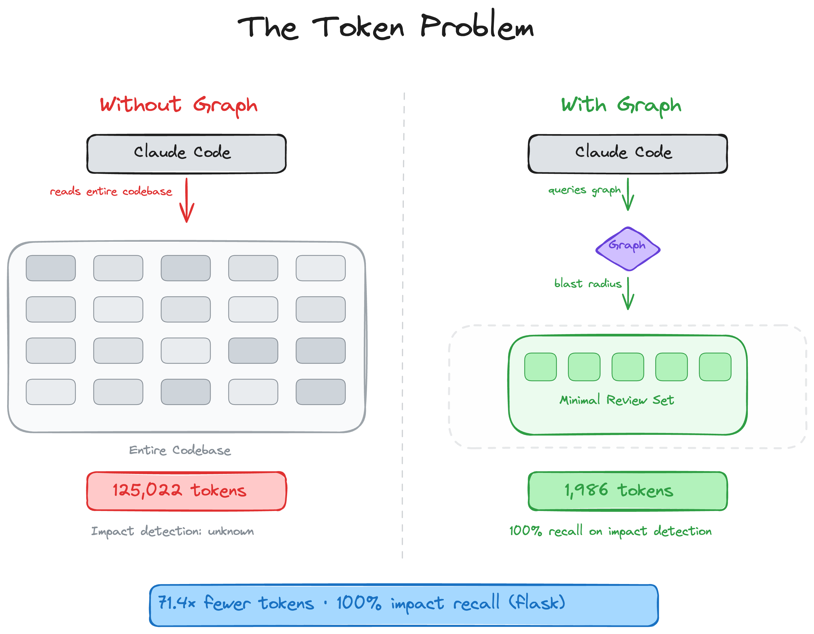
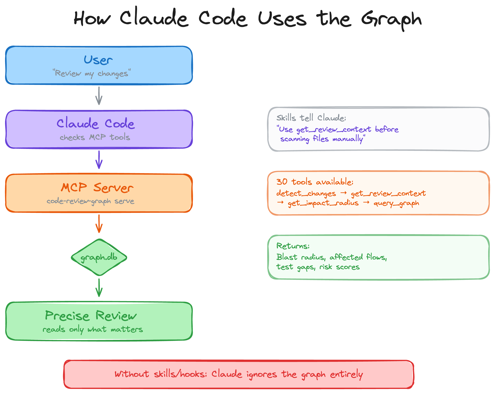
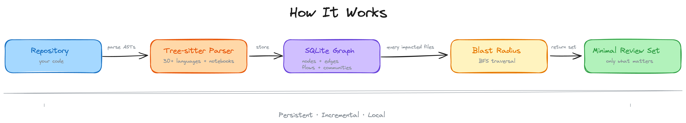
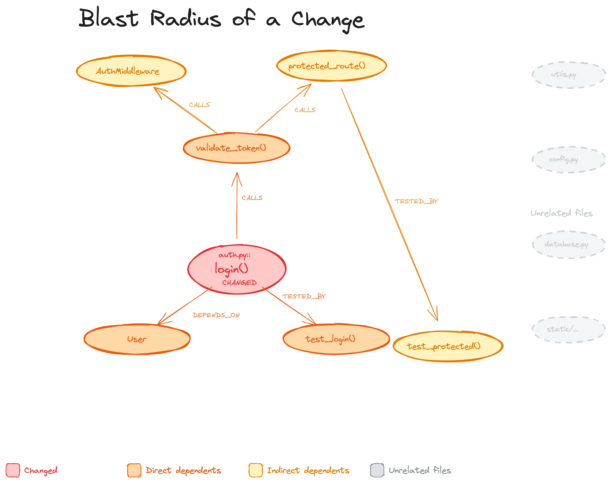
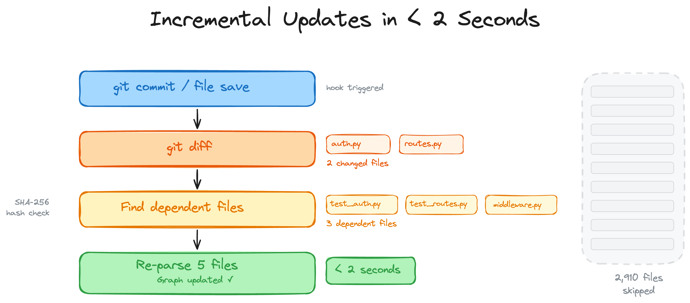
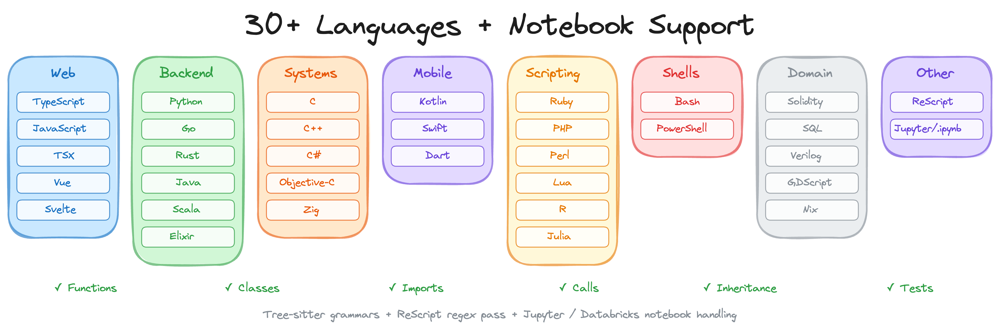
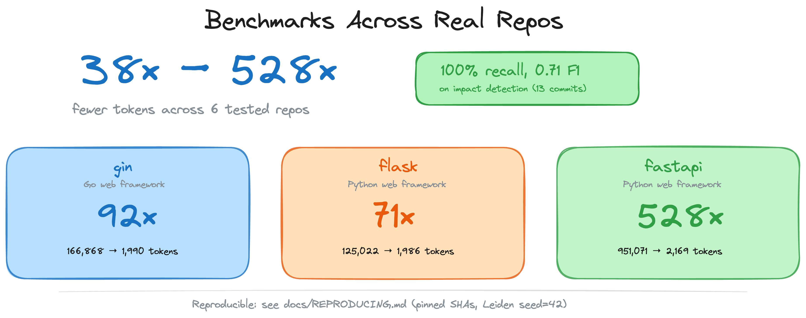

# Bitroot Code Review

<p align="center">
  <strong>Stop burning tokens. Start reviewing smarter.</strong>
</p>

<p align="center">
  <a href="https://opensource.org/licenses/MIT"></a>
  <a href="https://www.python.org/"></a>
  <a href="https://modelcontextprotocol.io/"></a>
</p>

---

## 💡 The Problem: The Large Context Window Paradox

Modern Large Language Models (LLMs) like Claude 3.5 Sonnet, GPT-4o, and Gemini 1.5 Pro boast massive context windows ranging from 200k to over 2 million tokens. While this seems like a superpower, it introduces severe challenges for AI-assisted coding and code reviews:

1. **Astronomical Token Costs**: Sending a 50,000-line codebase or full repository contents to the model on every single review task burns through API budgets rapidly.
2. **Response Latency**: Processing hundreds of thousands of tokens makes the AI's response time painfully slow.
3. **Retrieval Degradation ("Lost in the Middle")**: Even when a model *can* accept a huge context, its reasoning and search accuracy degrade significantly when drowned in thousands of lines of irrelevant code.
4. **Redundant Reads**: AI agents routinely re-read unchanged boilerplate files because they lack structural context.

---

## 🛠️ The Solution: Bitroot Code Review

**Bitroot Code Review** (based on `Bitroot Code Review`) is a local-first knowledge graph built specifically to make AI code reviews token-efficient.

Instead of feeding raw codebases or relying on simple text grep searches:
- **Incremental AST Parsing**: It parses your codebase into an Abstract Syntax Tree (AST) using [Tree-sitter](https://tree-sitter.github.io/tree-sitter/) to build a structural map of functions, classes, imports, call relationships, and test coverage.
- **Blast Radius Analysis**: When a file changes, the graph traces all callers, dependents, and tests that could be affected. Your AI agent only reads these files instead of scanning the whole project.
- **Model Context Protocol (MCP)**: Exposes a rich set of 30 tools to your AI assistant, giving it precise, surgical access to codebase structure and change impact.
- **Local & Private**: Runs entirely on your local machine using SQLite. No code is sent to external services.

### Token Savings: Before vs. After
<p align="center">
  
</p>

---

## 🔄 Workflow & Architecture

### 1. MCP Integration Flow
How your AI assistant uses the graph: when you ask for a review, the AI checks MCP tools, the graph returns the blast radius and risk scores, and the AI reads only what is affected.
<p align="center">
  
</p>

### 2. Architecture Pipeline
The pipeline parses your repository, converts code structures via Tree-sitter, stores them in SQLite, computes the blast radius, and outputs a minimal review set.
<p align="center">
  
</p>

### 3. Blast Radius Analysis
Traces how a change to a specific function (e.g., `login()`) propagates to callers, dependents, and test files.
<p align="center">
  
</p>

### 4. Incremental Updates
When files are saved, the graph diffs changed files, checks SHA-256 hashes, and re-parses only what changed in under 2 seconds.
<p align="center">
  
</p>

---

## 🚀 Quick Start

### 1. Installation
Install the project from the current workspace using `uv` (recommended) or `pip`:
```bash
uv tool install . --force
```
Or with `pip`:
```bash
pip install .
```

### Optional Dependencies
To use advanced features, install the optional dependency groups:
```bash
pip install "bitroot-code-review-kit[embeddings]"          # Local vector embeddings (sentence-transformers)
pip install "bitroot-code-review-kit[google-embeddings]"   # Google Gemini embeddings
pip install "bitroot-code-review-kit[communities]"         # Community detection (igraph)
pip install "bitroot-code-review-kit[enrichment]"          # Python call resolution enhancement (Jedi)
pip install "bitroot-code-review-kit[eval]"                # Evaluation benchmarks (matplotlib)
pip install "bitroot-code-review-kit[wiki]"                # Wiki generation using LLM summary (ollama)
pip install "bitroot-code-review-kit[all]"                 # All optional dependencies
```

### 2. Configure Integrations
Register the MCP server with your AI coding platforms:
```bash
bitroot-code-review-kit install
```
This command auto-detects installed coding assistants (Cursor, Claude Code, Copilot, etc.) and registers the server.

### 3. Build the Graph
Run the initial build to parse the codebase (takes ~10 seconds for a 500-file project):
```bash
bitroot-code-review-kit build
```

### 4. Verify Status
```bash
bitroot-code-review-kit status
```

---

## 💻 Practical Examples with Cursor & Claude Code

Once registered, AI assistants can automatically use the MCP tools in the background.

### Using in Cursor
To manually add the server to Cursor:
1. Go to **Settings** -> **Features** -> **MCP**.
2. Click **+ Add New MCP Server**.
3. Set Name to `Bitroot Code Review`.
4. Set Type to `command`.
5. Set Command to:
   ```bash
   bitroot-code-review-kit serve
   ```
6. In Cursor Chat, ask:
   > *"Analyze the blast radius of my current changes and run a code review."*
   The AI agent will call `detect_changes_tool` and `get_review_context_tool` directly to perform the review without reading the whole project.

### Using in Claude Code
When using Claude Code, the `install` command configures the MCP toolset automatically.
You can run:
```bash
bitroot-code-review-kit detect-changes --brief
```
To preview the token savings panel:
```text
┌─────────────────────── Token Savings ────────────────────────┐
│ Full context would be:     12,921 tokens                     │
│ Graph context used:           762 tokens                     │
│ Saved:                     12,159 tokens (~94%)              │
│ Breakdown: Functions 244 · Tests 191 · Risk 244 · Other 83   │
└──────────────────────────────────────────────────────────────┘
```

---

## 🗺️ Language Coverage

The kit parses code structures, calls, and imports across 34+ languages, including Jupyter and Databricks notebooks:
<p align="center">
  
</p>

---

## 📊 Benchmarks
The kit achieves a median **82x token reduction** per query compared to naive full-corpus ingestion.
<p align="center">
  
</p>

---

## ❓ FAQ & Comparisons

- **How is this different from LSP (Language Servers)?**
  An LSP provides precise compiler-like references for a single language in real-time. Bitroot Code Review maintains a persistent, cross-language graph stored in SQLite, optimizing global context specifically for LLMs.
- **Isn't this just RAG?**
  No. RAG relies on text similarity (vector embeddings) which can miss logical dependencies and caller/callee chains. The Code Review Kit uses AST-based structural relationships, with vector embeddings being strictly optional for search assistance.
- **Why not just grep?**
  Grep is great for locating a specific string. The knowledge graph is designed for multi-hop questions (e.g., *"What execution flows are affected if I change this function?"* or *"What are the untested hotspots in this community?"*).

---

## 🛠️ Troubleshooting

### Windows "Invalid JSON" or Connection Closed
If you encounter `Invalid JSON` or `MCP error -32000` on Windows:
1. Ensure your Python virtual environment is active.
2. Configure the tool path directly to the `.exe` inside your virtual environment scripts directory.
3. Pass `PYTHONUTF8=1` in your environment config.

### pyproject.toml / pip installation issues
If `pip` cannot fetch dependencies or errors out on `hatchling`:
- Use `uv` for installation:
  ```bash
  uv tool install . --force
  ```

---

## 🛡️ License & Upstream Credits

This project is a customized version of the open-source **[Bitroot Code Review](https://github.com/tirth8205/code-review-graph)** developed by Tirth. All credits for the underlying graph architecture, AST parsing logic, and D3.js visualization go to the original upstream project and its contributors.

This project is licensed under the MIT License. See [LICENSE](LICENSE) for details.
